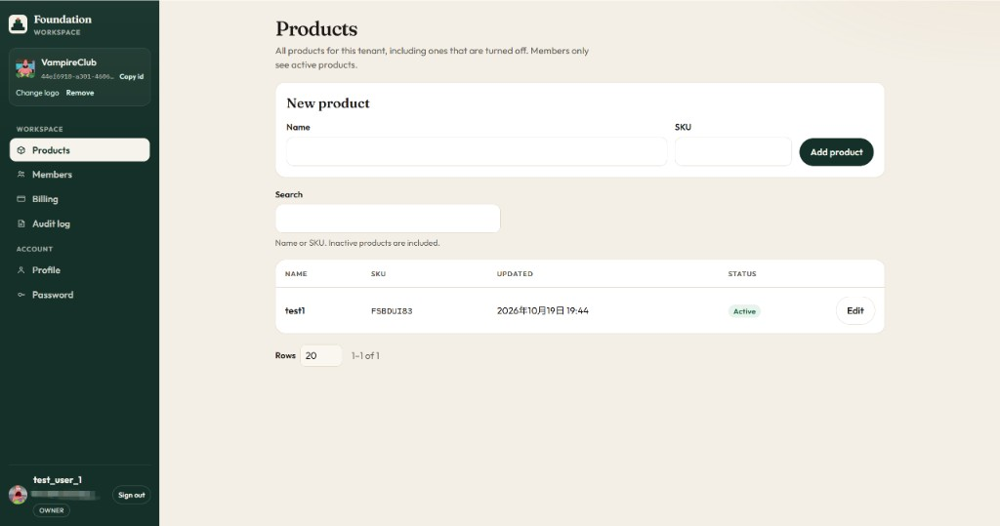
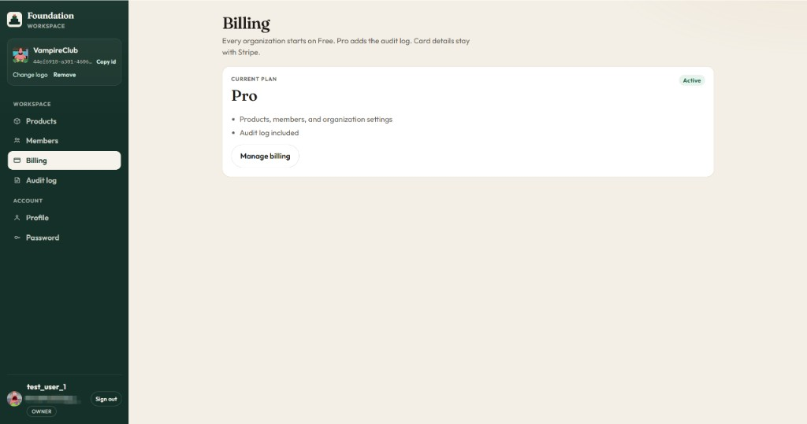
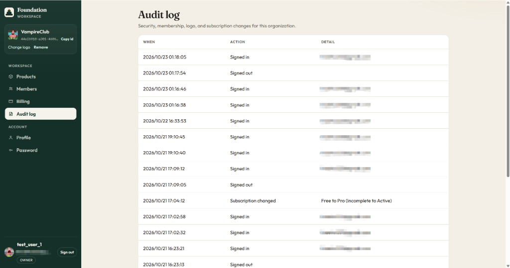
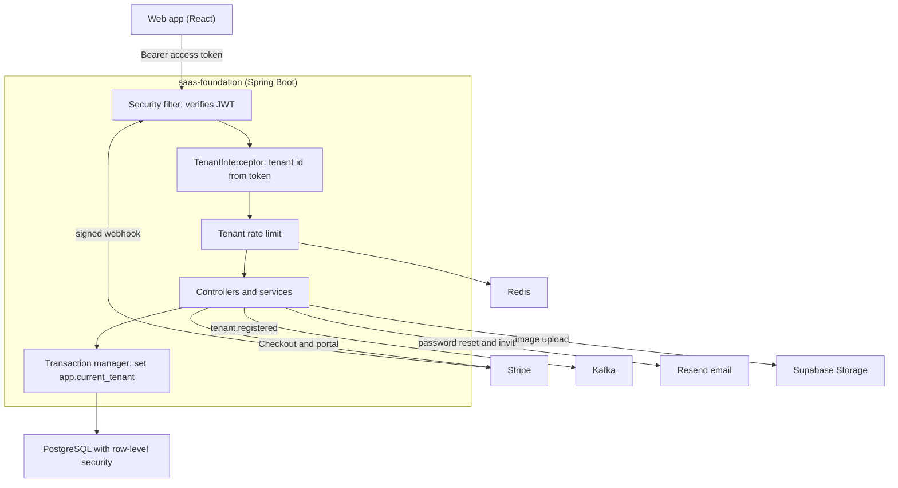

# saas-foundation

[](https://github.com/TiaoTiaoLin/saas-foundation/actions/workflows/ci-cd.yml)

Multi-tenant SaaS API for one organization per tenant. Products are the sample resource. Free includes the product catalog, members, and organization settings. Pro is a Stripe subscription and is what opens the audit log.

The browser app is [saas-foundation-web](https://github.com/TiaoTiaoLin/saas-foundation-web). Try it at <https://saas-foundation-web.linzehui233.workers.dev/>.

The API is deployed on Render. The first request after idle can take half a minute while the service wakes.

## What it covers

- **Tenant isolation** in PostgreSQL with row-level security, backed by a Hibernate filter.
- **Auth** with short-lived JWT access tokens, rotating refresh tokens with reuse detection, password reset, and per-IP and per-account rate limits.
- **Roles** (owner, admin, member), invites by email, and an account that can belong to several organizations.
- **Billing** with Stripe Checkout, the customer portal, and an idempotent, order-safe webhook.
- **Audit log** that the application role can only append to.
- **Operations**: Flyway migrations, health probes, Prometheus metrics, Resilience4j around email, Kafka for the signup event, Redis for rate limits and caching.

## Screenshots

From the [web app](https://github.com/TiaoTiaoLin/saas-foundation-web), which calls this API.



| Billing, Pro plan | Audit log, opened by Pro |
| --- | --- |
|  |  |

## Architecture



Every request carries the tenant in its access token. The transaction manager copies it into a PostgreSQL setting at the start of each transaction, and the database policy does the rest. Even a query that forgets a `WHERE tenant_id = ...` cannot return another organization's rows.

## API documentation

With the API running, Swagger UI is at <http://localhost:8080/swagger-ui.html> and the OpenAPI document is at <http://localhost:8080/v3/api-docs>. Call `POST /api/v1/auth/login`, then paste the access token into **Authorize**.

## Walk through the deployed app

1. Open <https://saas-foundation-web.linzehui233.workers.dev/> and create an organization.
2. Add a product. A member of that organization sees only that organization's products.
3. Invite a second account from Members. The person must already have an account, and they join only after they accept the email.
4. Upgrade to Pro from Billing. Checkout uses Stripe test mode. Card `4242 4242 4242 4242`, any future expiry, any CVC. The success page does not change the plan. The webhook does. Refresh billing after it arrives, then open Audit log.

## Run locally

Java 21, Docker, and Maven.

```bash
docker compose up -d
mvn spring-boot:run
```

The API listens on port 8080. Postgres is `localhost:5432/saas_foundation` (`saas_app` / `saas_app` for the app, `saas` / `saas` for Flyway). Redis is on port 6379. Kafka is on port 9092.

Start the web app from its own repo with `npm install` and `npm run dev`, then open <http://localhost:5173>. The dev server proxies `/api` to port 8080.

Email and billing stay quiet until these are set:

| Variable | Used for |
| --- | --- |
| `RESEND_API_KEY`, `RESEND_FROM` | Password reset and invite email |
| `STRIPE_SECRET_KEY`, `STRIPE_WEBHOOK_SECRET`, `STRIPE_PRO_PRICE_ID` | Checkout, the customer portal, and the webhook |
| `APP_BASE_URL` | Links in those emails and the Stripe return URLs. Locally this is `http://localhost:5173` |

The `local` profile turns on debug logging. It requires the Resend variables.

```bash
mvn spring-boot:run -Dspring-boot.run.profiles=local
```

## Tests

`mvn verify` runs the unit tests, then the Testcontainers integration tests (`*IT`), which need Docker. Without Docker the integration tests are skipped, not failed. JaCoCo writes the coverage report to `target/site/jacoco/index.html`, and CI uploads it as the `jacoco-report` artifact.

The integration tests cover tenant isolation and row-level security, signup, login, invites, rate limits, the Kafka pipeline, and Stripe webhook races (`BillingWebhookConcurrencyIT`).

## Kubernetes

`k8s/` holds a Deployment, a Service, and a ConfigMap. Credentials come from a Secret that you create from `k8s/secret.example.yaml`. The manifests use the `prod` profile, so they expect managed Postgres, Redis (TLS), and Kafka (SASL over TLS). CI validates the manifests with kubeconform and fails if `application-prod.yml` needs a variable that neither the ConfigMap nor the Secret template provides. CI does not deploy them. The service itself runs on Render.

```bash
kubectl apply -f k8s/configmap.yaml
cp k8s/secret.example.yaml k8s/secret.yaml   # fill in the values
kubectl apply -f k8s/secret.yaml -f k8s/service.yaml -f k8s/deployment.yaml
```

Replace `IMAGE_PLACEHOLDER` in `k8s/deployment.yaml` with a pushed image first. The CI run on `main` produces a copy with the right tag as the `k8s-manifests-*` artifact.

## Local profile

The `local` profile lets requests through without a token, so the API refuses to start if `local` and `prod` are both active.

## Decisions

**Tenant isolation.** Every product row is owned by one tenant. On each request the tenant comes from the access token. The transaction sets PostgreSQL `app.current_tenant`, and row-level security on `products` allows a row only when `tenant_id` matches that setting. Tenant-scoped entities also pass through a Hibernate filter. A request cannot read another organization's products by changing an id.

**Two database logins.** Row-level security only protects data when the app connects as a role that does not bypass it. Supabase's default `postgres` login has `BYPASSRLS`, so the deployed app uses a separate `saas_app` role (`docker/postgres/supabase-app-role.sql`) for requests, and the owner login only for Flyway migrations. Put no `user=` or `password=` in `DB_URL`, because the JDBC driver would let them override `SPRING_DATASOURCE_USERNAME` and `SPRING_DATASOURCE_PASSWORD`. Set the app login with `SPRING_DATASOURCE_USERNAME` and `SPRING_DATASOURCE_PASSWORD`, and the migration login with `SPRING_FLYWAY_USER` and `SPRING_FLYWAY_PASSWORD`.

**The webhook grants Pro.** Stripe redirects the browser to `/billing?checkout=success` before the subscription is stored. That page tells the owner to refresh. `checkout.session.completed` is the event that sets the plan to Pro when the session status is `complete`. `customer.subscription.updated` can arrive first, while the subscription is still `incomplete`, and that status stores Free. The handler keeps Stripe's `event.created` on the organization and ignores a snapshot older than the one already applied. A same-second `incomplete` event does not replace an active Pro subscription. A newer cancellation still does.

**The audit log is append-only.** `audit_events` records sign-in, password changes, invites, role changes, removals, logo changes, and plan changes. The application role can insert and select. The database refuses an update, a delete, or a truncate from that role, and `AuditAppendOnlyIT` checks it. There is no foreign key to the user or the organization, so a row remains after the account is deleted. Owners on an active Pro plan can read the log. Past-due Pro keeps the plan and closes the log until the payment is current.

## Billing incident, October 19 2026

A paid test subscription stayed on Free and the billing page showed Incomplete.

Stripe created the subscription as `incomplete`, then sent `customer.subscription.updated` at 7:32:07 PM and `checkout.session.completed` at 7:32:08 PM. The subscription update was stored as Incomplete and Free. The checkout event is the one that would have set Pro. Its first delivery returned HTTP 500, so that transaction rolled back. Both events write the same versioned tenant row, and they arrived one second apart. The later retries timed out because the Render service was asleep, so they never committed either.

Resending `checkout.session.completed` while the service was awake set the organization to Pro. The event-time check above is what keeps a late delivery of the older `incomplete` snapshot from undoing that.

Fix for the race itself: the webhook now retries up to three times when its transaction loses the optimistic-lock race on the tenant row, or when the same event is delivered twice at once. Each attempt reloads the row in a new transaction and checks `billing_events` again. If every attempt conflicts, the response is an error (409 for a lock conflict), so Stripe redelivers. `BillingWebhookConcurrencyIT` sends the two events from separate threads against a real PostgreSQL and asserts the organization ends on Pro.
